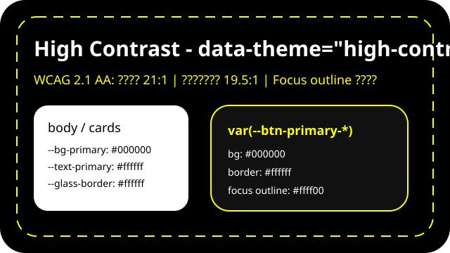

:summary: ארכיטקטורת הצבעים, משתני ה-CSS והבדיקות שנדרשות לשימור חוויית הממשק בכל ערכות הנושא. מקור האמת לכל שינוי ב-CSS של ה-WebApp.

מערכת ערכות הנושא והטוקנים החדשה
=================================

.. contents::
   :depth: 2
   :local:

רקע ומוטיבציה
-------------

- בריפקטור האחרון הוסרו צבעים ייחודיים מקבצים כגון ``global_search.css`` והופיעו באגים של *black/white zebra*, איבוד גרדיאנטים ולבן מסנוור ב‑Live Preview.  
- עדכוני Theme נקודתיים בעבר חזרו לצבעים קשיחים (HEX/RGB) ולכן נשברו ב‑Classic/Ocean/Forest שנוספו מאוחר יותר.  
- מטרת המערכת החדשה: ריכוז כל המשתנים ב‑שלוש שכבות, צמצום FOUC (קביעת ``data-theme`` עוד לפני טעינת ה‑CSS), שימור נגישות וייחודיות, והגדרה ברורה של מה חייב Override בכל Theme.  
- ההנחיות כאן מחליפות קוד קשיח ותלויות מערכת הפעלה (``prefers-color-scheme``) ומייצרות תשתית אחת עבור Theme Builder, Split View, Collections, Markdown Viewer ועוד.  

שכבות משתנים וטעינת ``data-theme``
-----------------------------------

**Level 1 – Primitives (:root ב‑``webapp/templates/base.html``)**  
קבועים לכולם, ומרוכזים בבלוק ה‑``

- כאשר מבצעים Override לתמה קיימת (בידיים היום או דרך Theme Builder בעתיד), כתבו את הטוקנים בתוך ``:root[data-theme="ocean"]`` באותו `<style>` כך שהערכים הדינמיים יגברו על ברירת המחדל.
- טוקנים חובה ל‑Theme מותאם אישית (גם בעתיד כשה‑Builder יהיה פעיל): `--primary`, `--secondary`, `--bg-primary`, `--bg-secondary`, `--text-primary`, `--text-secondary`, `--btn-primary-bg`, `--btn-primary-color`, `--glass`, `--md-surface`, `--md-text`.

בדיקות חובה לפני Merge
----------------------

- מעבר ידני על כל 8 הערכות דרך Theme Wizard + בדיקה מהירה של `localStorage`.
- בדיקת Split View + Markdown Preview (כולל לחצן "רקע לבן", מצבי Reader).
- בדיקת Live Preview / Sticky Notes / Login alert / RTL. הגלילה החלקה כבויה כברירת מחדל (ראו :doc:`smooth-scrolling`); לבדיקה נקודתית שלה מוסיפים ``?smooth_debug=1`` לכתובת.
- בדיקת Collections, Bookmarks, אוספים משותפים וה‑Glass badges.
- בדיקת נגישות ב‑High Contrast (יחס ניגודיות 4.5:1, focus outline, קישורים).
- עוגנים לטסטי דפדפן: אלמנט שטסט צריך לזהות מקבל ``data-testid`` שמתאר את **המצב שרונדר** (למשל ``agg-time-not-measured``), לא את הניסוח. הטסט נתלה בו ולא במחרוזת UI בעברית — שינוי ניסוח לא מפיל טסט, רינדור של הענף הלא נכון כן. ``data-testid`` אינו hook ל‑CSS ואין לעצב לפיו. כשלאלמנט כבר יש חוזה סמנטי יציב (``href``, ``id``, ``name``) — משתמשים בו ולא מוסיפים ``data-testid``. תקדים: ``webapp/templates/profiler_dashboard.html``.
- בדיקת שאין HEX קשיחים בקבצים שנגעתם בהם (`rg "#[0-9a-fA-F]{3,6}" webapp/static/css/<file>.css`).
- בדיקת WCAG ל‑Markdown Viewer (``bg-sepia`` ועוד) + ווידוא ש‑`--md-surface` לא הוחלף בטעות.
- מעבר בין Themes בזמן Live Preview כדי לוודא שאין FOUC (שימרו על setAttribute מוקדם).

שימושים נוספים וחריגים
----------------------

.. warning::

   ⚠️ **שים לב:** Sticky Notes, Reader Modes (`md_preview.html`) והקובץ ``theme_preview.html`` נשארים Hardcoded בכוונה לצורכי Preset/Brand. אין להמיר אותם ל‑``var()`` עד שתתועד חלופה רשמית, אחרת נשבור תצוגות קיימות.

- Collections (`webapp/static/css/collections.css`) עדיין מכיל צבעים קשיחים ישנים – כל שינוי חייב להמיר ל‑`var()` לפי טבלת הטוקנים.
- **וו דריסה לערכה בודדת (Collections).** שם הקובץ בכרטיס אוסף הוא ``<a>``, ולכן ``dark-mode.css`` צובע אותו ב-``var(--primary)`` דרך ``[data-theme="custom"] a`` — ספציפיות שגוברת על כלל המחלקה שב-``collections.css``. כרטיס האוסף נשאר לבן גם בערכה כהה, כך שערכה שה-``--primary`` שלה בהיר מקבלת שם קובץ בלתי קריא. הפתרון אינו דריסה גורפת אלא **וו בהצטרפות מרצון**: שני כללים על ``.collection-card__link`` ועל ``.workspace-card__link`` — שני המסכים שמציגים שמות קבצים — קוראים ``var(--collections-link-override, <הערך שנצבע היום>)`` — ``--primary`` במצב רגיל, ``--primary-dark`` ב-``:hover``. **הטוקן חייב להישאר ללא ערך ברירת מחדל בשום מקום**, אחרת ה-fallback לא נכנס לפעולה וכל ערכה מושפעת. זה בדיוק מה שקרה בניסיון הראשון: ברירת מחדל שנקבעה ב-``:root[data-theme-type="custom"]`` שינתה את ה-``:hover`` גם בערכות שלא הצהירו, והורידה אותן מניגודיות 4.81 ל-1.00. ל-``:hover`` נדרש כלל נפרד כי ``[data-theme="custom"] a:hover`` ספציפי יותר. ראו :ref:`theme-variables-override-hook`.
- **וו דריסה לערכה בודדת (הצעות החיפוש הגלובלי).** אותו שורש, ברכיב אחר: ההצעות מרונדרות ב-``global_search.js`` כאלמנטי ``<a>``, ורקע התיבה הוא ``--solid-surface-bg`` שנשאר לבן בכל ערכה — ולכן ``[data-theme="custom"] a`` צובע טקסט בצבע המותג של הערכה על רקע שאינו שלה. נמדד בדפדפן על הדף המרונדר: ערכה שה-``--primary`` שלה לבן מקבלת ניגודיות 1.00, כלומר טקסט בלתי נראה עד שמעבירים עליו עכבר. הווו נבנה באותה צורה בדיוק — ``var(--search-suggestion-text-override, <הערך שנצבע היום>)`` — אבל כאן **שלושה** כללים ולא שניים, כי ל-``:focus-visible`` יש ערך משלו: ``.search-suggestion:focus-visible`` הוא (0,2,0) ומנצח כבר היום את כלל ה-``<a>`` שהוא (0,1,1), ולכן נצבע ב-``--suggestions-text`` ולא ב-``--primary``. **סדר הכללים אינו שרירותי:** ``:hover`` ו-``:focus-visible`` שווים בספציפיות (0,3,0), ולכן כלל ה-``:hover`` נכתב אחרון — כך המצב המשולב נשאר ``--primary-dark``, מה שנצבע שם היום. ``tests/services/test_theme_variables_search_suggestion_hook.py`` נועל את הסדר הזה. ראו :ref:`theme-variables-search-suggestion-hook`.
- **וו דריסה לערכה בודדת (בלוקי הקוד בדפדפן הריפו).** בערכה מיובאת, ``markdown-preview.css`` צובע את המעטפת של תצוגת ה-Markdown ב-``--bg-tertiary``, את בלוק הקוד ב-``--code-bg`` ואת הגבול שלו ב-``--border-color`` (דרך ``--md-preview-border``, ראו בהמשך). כל אחד מהם נגזר ממפתח אחר של VS Code, וכשהשלושה יוצאים באותו צבע — כמו ב-Cobalt Next — הבלוק נבלע בטקסט שסביבו. ``--code-bg`` עצמו לא נדרס, כי הוא צובע גם רכיבי קוד אחרים; במקומו שני טוקנים חדשים, ``--repo-md-code-block-bg-override`` ו-``--repo-md-code-block-border-override``. **הם נקראים בכלל הקיים** ``[data-theme="custom"] .markdown-preview-content pre`` (ו-``shared:``), ולא בכלל חדש עם ``[data-theme-type="custom"]``: זה הכלל שצובע היום את הבלוק בערכה מיובאת, (0,2,1) מול (0,1,1) של הכלל הכללי, ובורר זהה פירושו מפל זהה לערכה שאינה מצהירה. הגבול נקבע ב-``border-color`` ולא ב-``border``, והעובי והסגנון נשארים של הכלל הכללי. ראו :ref:`theme-variables-repo-md-code-block-hook`.
- **וו דריסה לערכה בודדת (הטקסט בכפתורי primary).** כפתור primary שהוא ``<a>`` נצבע בערכה מיובאת דרך ``[data-theme="custom"] a`` שב-``dark-mode.css``, אותו שורש של ווי האוספים והחיפוש שמעל. בנוסף, ``.file-primary-action`` ב-``view_file.html`` צובע ב-``--primary`` את "ערוך" ו"העתק קוד", ובלוק ``primary-btn-states-custom-type`` ב-``base.html`` צובע בו, ב-``!important``, את מצבי הפוקוס, הלחיצה וההשבתה של כל כפתור primary, ואת כל כפתורי ה-primary בערכה משותפת. ``--btn-primary-text-override`` נקרא בכל אחד מהם, עם fallback לערך שהוא צבע עד היום. בכללים הקיימים הטוקן נקרא בלי לשנות את הבורר. לקישורים נוספו ב-``dark-mode.css`` שני כללים, רגיל ו-``:hover``, והבוררים שלהם הם הבוררים של כללי הקישורים עצמם עם ``:where(.btn-primary)``. ``:where()`` אינו מוסיף ספציפיות, והכללים כתובים מיד אחרי כללי הקישורים, ולכן הם חלים בדיוק במקום שבו כללי הקישורים צובעים היום, וכלל ספציפי יותר ממשיך לנצח. **לא** ``[data-theme-type="custom"]``, בכוונה: ``previewTheme`` ב-``base.html`` מחליף את ``data-theme`` לערכה מובנית ומשאיר את ``data-theme-type``, וכלל שנשען עליו היה חל גם על התצוגה המקדימה הזו. ``tests/services/test_theme_variables_btn_primary_text_hook.py`` נועל את החוזה. ראו :ref:`theme-variables-btn-primary-text-hook`.
- **הקובץ המשותף של תצוגת ה-Markdown, וטוקני הרכיב שלו.** ``markdown-preview.css`` נטען בדפדפן הקוד וגם בעמוד הקבצים לאדמין, בכרטיסי החיפוש בתיעוד (:ref:`global-search-docs`). כל עמוד שטוען אותו יורש מ-``base.html``, אבל רק דפדפן הקוד טוען את ``repo-browser.css``, ורק שם מוגדרים ``--border-color`` ו-``--accent-blue``, בפלטה שב-``:root`` שלו. כלל משותף שקרא אותם ישירות נראה תקין בדפדפן הקוד בלבד: בעמוד הקבצים הקישורים יצאו בצבע הטקסט והגבולות ב-``currentColor`` (נמדד בדפדפן). לכן הקובץ מצהיר על ``.markdown-preview-container`` על טוקנים של הרכיב, ``--md-preview-border`` ו-``--md-preview-accent``, שקוראים את השניים עם fallback של אותה פלטה, והכללים המשותפים קוראים רק אותם. ההכרעה היא ירושה, כמו בתקדים של ``sticky-notes.css`` שבהמשך: ``--border-color`` של ערכה מיובאת גובר בכל עמוד, ובעמוד שלא מגדיר אותו נכנסת הפלטה של דפדפן הקוד. **זה חריג מתועד לאיסור על HEX בקבצי רכיבים:** ה-fallback הוא עותק של הפלטה, ו-``tests/test_markdown_preview_tokens.py`` שומר שהוא שווה לערך שב-``:root`` של ``repo-browser.css``, ושכל טוקן שכלל משותף קורא מוגדר בכל עמוד שטוען את הקובץ — ב-``base.html`` או בקובץ עצמו. וו דריסה (``--*-override``) אינו מוגדר בשום מקום בכוונה, ולכן נקרא תמיד עם fallback. **מה נמדד ב-7.10.2026:** בדפדפן הקוד אין אף הבדל לפני ואחרי, בכל הערכות; ובערכה מיובאת אמיתית הכרטיס זהה לדפדפן הקוד, גם בדגימת פיקסל של המשטח.
- Split View ו‑Markdown Enhanced משתמשים ב‑``--split-*`` ו‑``--md-*`` בהתאמה – הוסיפו טוקן לפני שמוסיפים Class חדש.  
- Sticky Notes, Reader Modes (`md_preview.html`) וה‑``theme_preview.html`` הם חריגים שנשארים Hardcoded כדי לשמור על תצוגת Preset.  
- **הכיוון ההפוך, וזה מה שהסעיף הזה לא אמר עד היום: משטח קשיח לא רק נמנע מ-**\ ``var()``\ **— הוא חייב לספק ערך לכל טוקן שכל רכיב שמוצג בתוכו קורא.** האיסור למעלה מכסה את מה שהמשטח עצמו מצהיר, ולא את מה שיושב בתוכו. רכיב משותף שמרונדר על משטח קשיח ממשיך לקרוא טוקני ערכה — והם נבחרו לרקע אחר לגמרי, כלומר צבע שגוי בדיוק במידה שהרקע לא השתנה. **קובץ CSS משותף אינו מספיק כאן**, וההיסק "זה אותו קוד ולכן זה נראה אותו דבר" נכון למבנה ולמידות ושגוי לצבע.

  התקדים: ``sticky-notes.css`` מצהיר על ``--sticky-mark-bg``/``--sticky-mark-line`` עבור ``.sticky-md-mark``, ועל ששת הטוקנים של הבלוק המתקפל — ``--details-bg``, ``--details-border``, ``--details-hover``, ``--summary-bg``, ``--summary-color``, ``--summary-arrow-color`` — שכולם בבעלות ``markdown-enhanced.css``. ההצהרות יושבות על ``.sticky-note``, וההכרעה היא **ירושה ולא ספציפיות**: הצהרת הערכה יושבת על ``<html>``, ולכן האב הקרוב מנצח בתת-העץ ואין צורך ב-``!important``. (‏``.sticky-md-mark`` כן צריך אותו, אבל מסיבה אחרת לגמרי — שם קיימים כללי ערכה שמכוונים ל-``mark`` **כאלמנט**.)

  **ומה שנמדד, כי בלי מדידה זה נראה תקין:** לפני התיקון יצא הטקסט בגוף הבלוק בניגוד של 1.09:1 בערכה מיובאת כהה, והחץ 2.09:1 **גם בערכה בהירה**. ‏``--summary-bg`` הוא גרדיאנט, ולכן הוא נוחת ב-``background-image`` ו-``background-color`` נשאר ``transparent`` — כלומר בדיקה שמודדת רק ``background-color`` עוברת גם על הקוד השבור. **צבע על משטח כזה נמדד בדגימת פיקסל.**

  **ומקרה שני של כללי ערכה שמכוונים לאלמנט — הקישור, ושם** ``!important`` **לבדו אינו מספיק.** קישור בפתק (``.sticky-md-link``) צבוע ב-``--note-link``, שמוצהר על ``.sticky-note`` כמו הדיו. היריבים הם ``[data-theme="…"] a`` ו-``a:hover`` ב-``dark-mode.css``, ו-``[data-theme="high-contrast"] a``, ``a:hover`` ו-``a:focus`` ב-``high-contrast.css`` — והאחרונים הם ``!important`` בעצמם. בין שתי הצהרות ``!important`` מאותו מקור מכריעה הספציפיות (CSS Cascade 5, סעיף 6.1), ולכן הפתרון של ``.sticky-md-mark`` — ``!important`` על מחלקה אחת, (0,1,0) — מנצח את כללי ``dark-mode.css`` ומפסיד ל-(0,1,1) של High Contrast: בבדיקה חד-פעמית ב-12.10.2026 נקרא ``getComputedStyle`` של קישור כזה בכרומיום 141, והוא נשאר צהוב. לכן הכלל בפתק כותב ``.sticky-note`` לפני המחלקה, ול-``:hover`` ול-``:focus`` יש בורר משלהם, כדי לעלות על (0,2,1) **ממש, ולא בשוויון**: ``note_board.html`` ו-``repo/base_repo.html`` טוענים את ``sticky-notes.css`` לפני קבצי הערכות, ו-``md_preview.html`` אחריהם, כך שבספציפיות שווה התוצאה הייתה תלויה במשטח. באותה בדיקה עלו גם שתי דליפות של מצב הריחוף שאינן ``color``: ``a:hover`` של ``dark-mode.css`` מוריד את ה-``opacity``, ו-``text-decoration`` של High Contrast הוא קיצור ``!important`` שמאפס גם את ``text-decoration-thickness`` — ולכן הקו המתעבה בריחוף צריך ``!important`` משלו. ``tests/test_sticky_notes_link_color.py`` גוזר את כללי ה-``a`` מקבצי הערכות ודורש שכל אחד מהם יפסיד בפתק, בחשיבות ובספציפיות.
- **מלכודת ספציפיות ב-**\ ``transition``\ **, שכל רכיב חדש נתקל בה.** ``dark-mode.css`` מגדיר ``transition`` על ``[data-theme="dark"] *`` (וכן ``dim``, ``nebula``, ``custom`` ו-``shared:``). הספציפיות של ``[attr] *`` שווה לזו של מחלקה יחידה, והקובץ נטען אחרי בלוק ``extra_css`` שבתבנית — ולכן כלל ``transition`` שנכתב על מחלקה אחת בקובץ רכיב **נדרס בשקט בכל הערכות הכהות**, וההנפשה פשוט לא רצה. הכשל שקט לחלוטין: אין שגיאה, ובדיקה בערכה בהירה עוברת. הפתרון שבשימוש ב-``toast.css`` הוא חזרה על שם המחלקה (``.ck-toast.ck-toast``), שמעלה את הספציפיות בלי ``!important``. אותו טיפול נדרש גם לכלל ה-``prefers-reduced-motion`` של הרכיב, שאחרת נדרס באותה דרך.
- **מלכודת קופסת גלילה ב-**\ ``overflow-x: hidden``\ **, שמשביתה כל אלמנט צמוד.** למניעת גלילה לרוחב כותבים ``overflow-x: clip``, ולא ``hidden``. לפי CSS Overflow 3, ``hidden`` בציר אחד הופך את הציר השני ל-``auto``, ולכן המיכל נעשה קופסת גלילה גם כשהוא אף פעם לא גולל, כי הגובה שלו הוא גובה התוכן. לפי CSS Position 3, ``position: sticky`` נצמד לקופסת הגלילה הקרובה, ולכן אלמנט צמוד בתוך מיכל כזה נגלל עם העמוד ולא נצמד — בלי שום שגיאה. ``clip`` חותך לרוחב בדיוק אותו דבר בלי להפוך את המיכל לקופסת גלילה, ואת ``hidden`` כותבים לפניו כנפילה-לאחור לדפדפן שאינו מכיר ``clip``. כך היו שבורים הסרגלים הצמודים בתצוגת קובץ, בתצוגת Markdown ובבונה הערכות, בגלל ``.main-content, .container`` ב-``base.html``; ומאותה סיבה ``global_search.css`` כותב ``clip`` ב-``.search-and-filters .filters-row``. **ושני דברים שבאים עם אלמנט שבאמת נצמד:** יעד שגוללים אליו עם ``block: 'start'`` — עוגן, תוכן עניינים — צריך ``scroll-margin-top`` בגובה הסרגל בזמן שהסרגל צמוד, אחרת הוא נוחת מתחתיו (ב-``md_preview.html`` הגובה נמדד ומפורסם כ-``--md-toolbar-h``, כי בטלפון הסרגל נשבר לכמה שורות, והרווח חל רק באותו תנאי שבו הסרגל נצמד — ראו בהמשך, הצמדה רק בזמן חיפוש); ופריט grid צמוד נע — נמדד בכרומיום — בתוך כל מיכל ה-grid ולא רק בתוך התא שלו, ולכן כשהעמודות נערמות הוא עלול לגלוש על הפריט שמתחתיו (ב-``theme_builder.html`` ההצמדה מבוטלת ב-``@media`` שבו הפריסה נערמת). ואת העמוד עצמו גולל ``body`` ולא החלון, וקוד שמניח אחרת לא עושה כלום — ראו Issue #3534. **והמעבר ל-**\ ``clip``\ **משחרר גם את מה שהמיכל חתך עד אז, ולא רק אלמנטים צמודים:** החלוניות של התפריטים בסרגל העליון נחתכו עד אז בתוך ``.navbar > .container``, ואחרי המעבר יצאו מתחת לסרגל אל מעל התוכן — ונפלו לשכבה שמתחת לתוכן (ראו בהמשך, ``z-index`` על אלמנט שאינו ממוקם). לכן אחרי שינוי כזה בודקים גם רכיבים צפים שבתוך המיכל, לא רק את מה שצמוד.
- ``z-index`` **על אלמנט שאינו ממוקם — מת; והורה שיוצר הקשר ערימה כולא בתוכו את ה-**\ ``z-index``\ **של הילדים.** לפי MDN, ``z-index`` חל על אלמנט ממוקם (``position`` שאינו ``static``) ועל פריטי flex ו-grid, ו-``transform`` או ``backdrop-filter`` שאינם ``none`` יוצרים הקשר ערימה, שרק בתוכו יש משמעות ל-``z-index`` של הצאצאים. ``.navbar`` שילב את שלושתם: ה-``z-index`` נשאר עליו מהימים שבהם היה צמוד (#559 הסיר את ההצמדה), ומאז שהוא ``static`` הערך מת; וה-``transform`` וה-``backdrop-filter`` שלו כלאו בתוכו את חלוניות הקיצורים והאפקטים. ``.main-content`` ממוקם עם ``z-index`` משלו ולכן מצויר מעל הסרגל, וכל חלק של חלונית שיצא מתחת לסרגל נראה — אבל הנגיעה בו הלכה לתוכן. **הפתרון אינו להרים את הסרגל לתמיד:** כפתורים וחלונות צפים שבתוך ``.main-content`` — ``#toggleBookmarksBtn`` בתצוגת קובץ, וחלונות שנפתחים על כל המסך — נשענים על כך שהסרגל מתחתם, ונמדד שהרמה קבועה מסתירה אותם בראש העמוד. במקום זה הסרגל עולה רק בזמן שאחד התפריטים שלו פתוח (``.navbar:has(...)`` ב-``base.html``), והמצב נקרא מה-``.active`` שמציג את התפריט ולא מדגל נפרד. תפריט צף חדש בסרגל נכנס לרשימה שם, ו-``tests/test_navbar_and_search_bars_css.py`` שומר עליה. ובאותו תיקון: חלונית האפקטים מעוגנת ב-``left`` ולא ב-``inset-inline-end``, כי ל-``.fun-mode-dropdown`` יש ``direction: ltr`` משלו, וצד לוגי מתורגם לפי הכיוון של האלמנט עצמו — כלומר ל-``right``, שפתח אותה אל מחוץ למסך.
- **הצמדה רק בזמן חיפוש.** הכלי הוא ``:has()`` עם ``:placeholder-shown``. סרגל חיפוש שצמוד תמיד מסתיר את ראש התוכן לאורך כל הגלילה, וחיפוש אינו שכיח מספיק כדי להצדיק את זה. לכן ``.editor-toolbar`` נצמד רק תחת ``.editor-toolbar:has(#codeSearchInput:not(:placeholder-shown))`` (ב-``view_file.html``), ו-``.md-editor-toolbar`` באותה צורה עם ``#mdSearchInput`` (ב-``md_preview.html``) — כלומר רק כשיש טקסט בתיבה — ובלי חיפוש הם נגללים עם העמוד. שני דברים שהתנאי נשען עליהם: לתיבה חייב להיות ``placeholder``, כי בלעדיו ``:placeholder-shown`` לעולם לא מתקיים והסרגל היה נצמד תמיד; ו-``:placeholder-shown`` מתעדכן גם כשהקוד מרוקן את התיבה (``input.value = ''``) — נמדד, ולכן ✕ משחרר את הסרגל בשתי התצוגות. דפדפן שאינו מכיר ``:has()`` מדלג על הכלל כולו, והסרגל פשוט לא נצמד.
- ``toast.css`` מגדיר את משפחת ``--ck-toast-*`` (Level 3), ונטען רק בעמודים שמציגים טוסט (``window.ckToast`` מ-``toast.js``) — ולא ב-``base.html``. מרחב השמות שלו נפרד מ-``.notification`` בכוונה: ``bookmarks.css`` ו-``multi-select.css`` מגדירים את הסלקטור ההוא בשניהם, עם ערכים סותרים. את ערכי הרקע והטקסט הוא מעתיק מ-``bookmarks.css`` במקום לגזור אותם מ-``--bg-secondary``; הגזירה נבדקה ונפסלה כי ב-Classic היא יורדת מתחת ליחס הניגודיות הנדרש.
- `global_search.css` הינו דוגמה מצוינת לרכיב Component Tokens – כאשר מוסיפים תכונה חדשה (למשל badge נוסף) המשיכו את התבנית שם.  
- Collections / Split View / Markdown Enhanced מוזכרים בדף זה כדי שמפתחים ידעו להצליב בין הרכיבים ולזהות אילו טוקנים משותפים.

קישורים ונספחים
----------------

.. seealso::

   - ``webapp/FEATURE_SUGGESTIONS/css_refactor_plan.md`` – רשימות טוקנים מלאות לפי קובץ.
   - ``FEATURE_SUGGESTIONS/css_refactor_plan.md`` – תקציר עסקי ובדיקות QA.
   - ``FEATURE_SUGGESTIONS/theme_matrix.md`` – טבלת כיסוי טוקנים מקוצרת.
   - ``webapp/FEATURE_SUGGESTIONS/webapp_theme_palettes.md`` – פירוט צבעים וערכי Markdown.
   - ``webapp/templates/base.html`` – בלוק ה‑``<style>``: מקור כל ה‑Primitives ו‑``:root[data-theme]``, קביעת ``data-theme`` מוקדמת, וה‑Theme Wizard.
   - ``webapp/static/css/dark-mode.css`` – שימוש בטוקנים עבור רכיבי Dark/Dim/Nebula.
   - ``webapp/static/css/high-contrast.css`` – טוקני הבסיס של High Contrast, ובנוסף התאמות פוקוס/Outline. שאר הטוקנים שלה מושלמים ברמת הרכיב.
   - ``webapp/static/css/global_search.css``, ``split-view.css``, ``bookmarks.css``, ``collections.css``, ``toast.css`` – דוגמאות מעשיות לטוקנים.
   - Issue #2097 – מפרט Theme Builder (טוקנים במיקוד, UI/Backend/API, נגישות ו‑Reset flow).

לשאלות תיעוד/Testing יש לפנות לערוץ Frontend או לפתוח Issue חדש עם קישור לדף זה. הקפידו לעיין גם ב‑`FEATURE_SUGGESTIONS/css_refactor_plan.md` לפני שינויים רוחביים בקוד.
