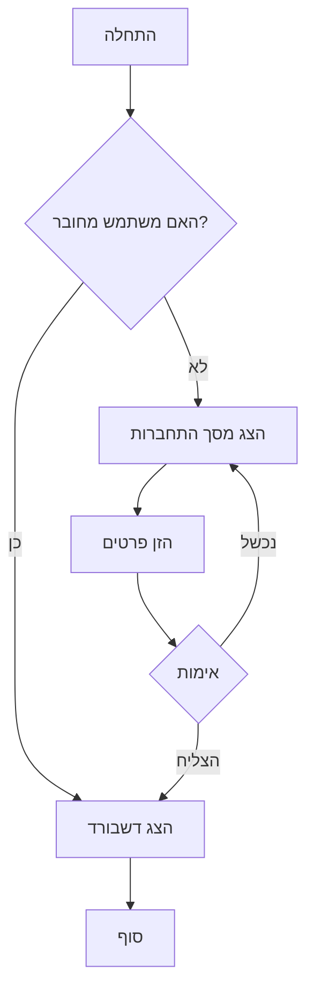
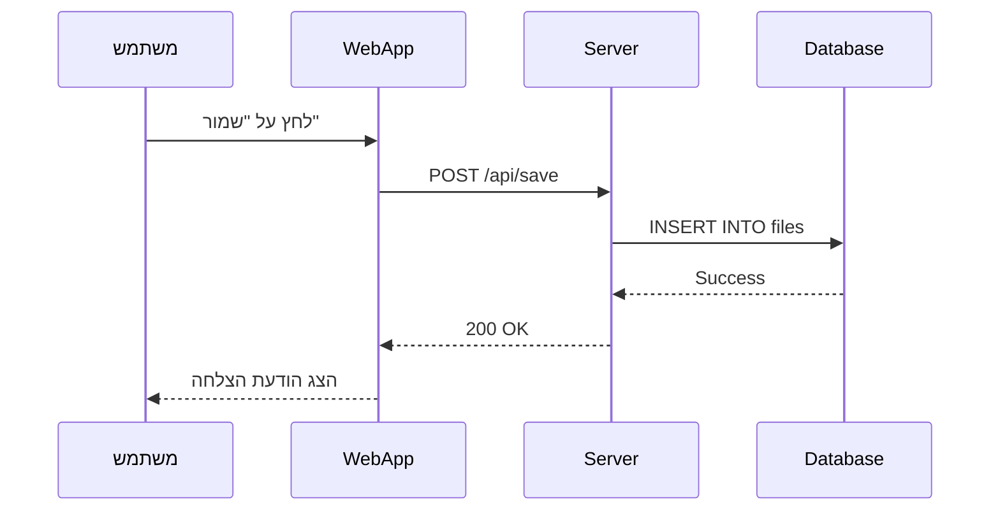
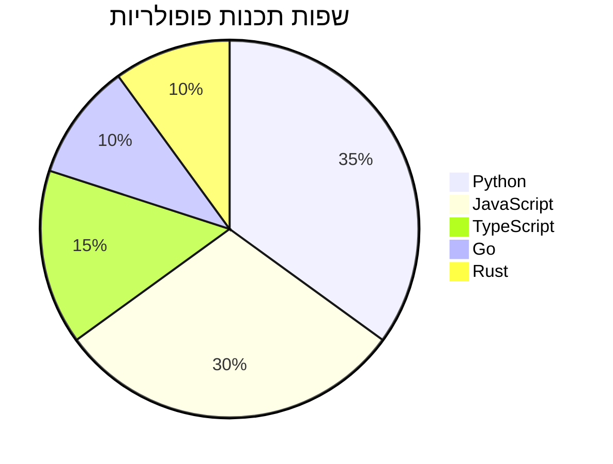

# ברוך הבא לעורך מארקדאון עם תמיכה בעברית של CodeKeeper 💫 

> דף זה מדגים את כל היכולות הנתמכות

## 📚 תוכן עניינים

- [אלמנטים בסיסיים](#אלמנטים-בסיסיים)
- [Task Lists](#task-lists)
- [טבלאות](#טבלאות)
- [קוד והדגשת תחביר](#קוד-והדגשת-תחביר)
- [מארקר (Highlight)](#מארקר-highlight)
- [התראות (Alerts)](#התראות-alerts)
- [קיצורי מקלדת בעורך](#קיצורי-מקלדת-בעורך)
- [קיפול (Collapsible)](#קיפול-collapsible)
- [נוסחאות מתמטיות](#נוסחאות-מתמטיות)
- [תרשימי Mermaid](#תרשימי-mermaid)

---

## אלמנטים בסיסיים

### טקסט מעוצב

- **טקסט מודגש** עם `**כוכביות**`
- *טקסט נטוי* עם `*כוכבית אחת*`
- ***טקסט מודגש ונטוי*** עם `***שלוש כוכביות***`
- ~~טקסט מחוק~~ עם `~~טילדות~~`
- ==טקסט עם מארקר== עם `==שני סימני שווה==`
- `קוד inline` עם backticks

### כותרות

# כותרת H1
## כותרת H2
### כותרת H3
#### כותרת H4

### רשימות

**רשימה לא ממוספרת:**
- פריט ראשון
- פריט שני
  - תת-פריט 2.1
  - תת-פריט 2.2
    - תת-תת-פריט
- פריט שלישי

**רשימה ממוספרת:**
1. שלב ראשון
2. שלב שני
   1. תת-שלב 2.1
   2. תת-שלב 2.2
3. שלב שלישי

### ציטוטים

> זהו ציטוט. ניתן להשתמש בו להדגשת טקסט חשוב.
>
> ציטוטים יכולים להכיל **עיצוב** ו[קישורים](https://github.com).

### קישורים

- [קישור לגיטהאב](https://github.com)
- [קישור עם כותרת](https://google.com "Google Search")
- קישור אוטומטי: https://example.com

---

## Task Lists

> רשימות משימות אינטראקטיביות - אפשר לסמן ולבטל סימון!

### משימות לביצוע:
- [x] התקנת ספריות Markdown
- [x] יצירת parser מתקדם
- [x] הוספת תמיכה ב-GFM
- [ ] הוספת תמיכה ב-plugins נוספים
- [ ] אופטימיזציות ביצועים
- [x] בדיקות ואינטגרציה

### רשימת קניות:
- [ ] חלב
- [x] לחם
- [ ] ביצים
- [x] גבינה
- [ ] ירקות

---

## טבלאות

טבלאות עם יישור מותאם:

| שם המוצר | מחיר | כמות | סה"כ |
|----------|------|------|------|
| מחשב נייד | ₪3,500 | 2 | ₪7,000 |
| עכבר | ₪150 | 5 | ₪750 |
| מקלדת | ₪250 | 3 | ₪750 |
| **סה"כ** | | | **₪8,500** |

### טבלה עם יישור:

| ימין | מרכז | שמאל |
|-----:|:----:|:-----|
| טקסט | טקסט | טקסט |
| 123 | 456 | 789 |
| א | ב | ג |

---

## קוד והדגשת תחביר

### Python
```python
def fibonacci(n):
    """חישוב סדרת פיבונאצ'י"""
    if n <= 1:
        return n
    return fibonacci(n-1) + fibonacci(n-2)

# דוגמה לשימוש
for i in range(10):
    print(f"F({i}) = {fibonacci(i)}")
```

### JavaScript
```javascript
// React Component
const MarkdownViewer = ({ content }) => {
    const [html, setHtml] = useState('');

    useEffect(() => {
        const rendered = markdownToHtml(content);
        setHtml(rendered);
    }, [content]);

    return (
        <div
            className="markdown-content"
            dangerouslySetInnerHTML={{ __html: html }}
        />
    );
};
```

### SQL
```sql
SELECT
    u.username,
    COUNT(f.id) as file_count,
    SUM(LENGTH(f.content)) as total_size
FROM users u
LEFT JOIN files f ON u.id = f.user_id
GROUP BY u.id
ORDER BY file_count DESC
LIMIT 10;
```

### Bash
```bash
#!/bin/bash

# Backup script
backup_dir="/backup/$(date +%Y%m%d)"
mkdir -p "$backup_dir"

# Backup database
mongodump --uri="$MONGODB_URL" --out="$backup_dir/db"

# Compress
tar -czf "$backup_dir.tar.gz" "$backup_dir"
rm -rf "$backup_dir"

echo "✅ Backup completed!"
```

---

## מארקר (Highlight)

הדגשת טקסט עם רקע צבעוני, באמצעות שני סימני שווה משני הצדדים:

- ==טקסט מודגש עם מארקר== נכתב כך: `==טקסט==`
- אפשר לשלב מארקר עם עיצוב אחר: ==טקסט **מודגש** בתוך מארקר==
- קיצור מקלדת: `Ctrl+Shift+H`

---

## התראות (Alerts)

בלוקי התראה צבעוניים בפורמט `:::` — פותחים בשורה עם `::: type`, כותבים את התוכן, וסוגרים בשורה עם `:::`.

::: note
זהו בלוק מסוג **note** — טיפים כלליים או תזכורות חשובות 🧭
:::

::: tip
זהו בלוק מסוג **tip** — עצה מעשית שתחסוך לך זמן 💡
:::

::: warning
זהו בלוק מסוג **warning** — שים לב, יש כאן משהו שעלול להשתבש ⚠️
:::

::: danger
זהו בלוק מסוג **danger** — פעולה מסוכנת שעלולה לגרום לנזק בלתי הפיך 🧨
:::

::: important
זהו בלוק מסוג **important** — מידע קריטי שאסור לפספס ❗
:::

::: info
זהו בלוק מסוג **info** — מידע רקע והסבר משלים 📘
:::

::: success
זהו בלוק מסוג **success** — הפעולה הושלמה בהצלחה 🎯
:::

::: question
זהו בלוק מסוג **question** — שאלה פתוחה או נקודה לבירור ❓
:::

::: example
זהו בלוק מסוג **example** — דוגמה קונקרטית להמחשה 🧩
:::

::: quote
זהו בלוק מסוג **quote** — ציטוט או אמירה שראוי להדגיש 💬
:::

::: experimental
זהו בלוק מסוג **experimental** — פיצ'ר בשלבי ניסוי, ייתכנו שינויים 🧪
:::

::: deprecated
זהו בלוק מסוג **deprecated** — רכיב מיושן שאין להשתמש בו יותר 🚫
:::

::: todo
זהו בלוק מסוג **todo** — משימה פתוחה שממתינה להשלמה 📝
:::

::: abstract
זהו בלוק מסוג **abstract** — תקציר של הנושא לפני הצלילה לפרטים 📄
:::

## ציטוט

### ציטוט רגיל

> CodeKeeper forever 💫

### ציטוט שבתוכו הדגשה

> **CodeKeeper forever** 💫

### ציטוט שבתוכו מארקר

> CodeKeeper forever ==now in production== 📨

---

## קיצורי מקלדת בעורך

| פעולה | קיצור |
|-------|-------|
| טבלה 📊 | `Ctrl+Shift+T` |
| קישור חכם 🔗 | `Ctrl+K` |
| מארקר 🎨 | `Ctrl+Shift+H` |
| קיפול 📂 | `Ctrl+Shift+D` |
| רשימת משימות ✅ | `Ctrl+Shift+C` |
| מעבר תצוגה/מקור | `Ctrl+M` |

---

## קיפול (Collapsible)

בלוק מתקפל שנפתח בלחיצה — שימושי להסתרת פרטים ארוכים. קיצור מקלדת: `Ctrl+Shift+D`.

::: details לחצו כאן לתוכן מוסתר


זהו התוכן המוסתר. אפשר לכלול כאן **עיצוב**, רשימות, ואפילו בלוקי קוד:

```python
print("hello from a collapsed block")
```

:::


---

## נוסחאות מתמטיות

### נוסחאות Inline
הנוסחה המפורסמת של איינשטיין: $E = mc^2$

משוואה ריבועית: $x = \frac{-b \pm \sqrt{b^2 - 4ac}}{2a}$

### נוסחאות Display

$$
\int_{-\infty}^{\infty} e^{-x^2} dx = \sqrt{\pi}
$$

$$
\sum_{n=1}^{\infty} \frac{1}{n^2} = \frac{\pi^2}{6}
$$

### מטריצה

$$
\begin{bmatrix}
a_{11} & a_{12} & a_{13} \\
a_{21} & a_{22} & a_{23} \\
a_{31} & a_{32} & a_{33}
\end{bmatrix}
\times
\begin{bmatrix}
x_1 \\ x_2 \\ x_3
\end{bmatrix}
=
\begin{bmatrix}
b_1 \\ b_2 \\ b_3
\end{bmatrix}
$$

---

## תרשימי Mermaid

### תרשים זרימה



### תרשים רצף



### תרשים עוגה




::: success
🎯 ==רינדור מארקדון הושלם בהצלחה!==
:::
